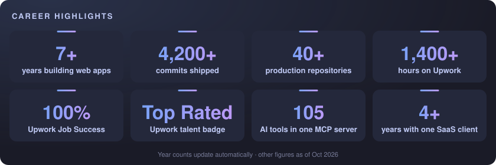
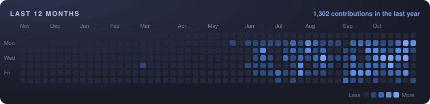

<p align="center">
  <a href="https://www.upwork.com/freelancers/~0135d9781ef7f212a9"></a>
</p>

<p align="center">
  <a href="https://www.upwork.com/freelancers/~0135d9781ef7f212a9"></a>
  <a href="https://www.linkedin.com/in/vivek-vaghela"></a>
  <a href="mailto:vaghelavivek150@gmail.com"></a>
  <a href="https://cutyears.com"></a>
</p>

---

### About me

I build SaaS products end to end and connect them to AI. I'm a core developer on a family of production SaaS products: a funnel and sales-page builder, a course and community platform, a membership platform, a quiz builder and a local SEO tool.

### Currently

- Shipping AI features and **MCP connectors** across a family of SaaS products
- Building a **local SEO SaaS** in Next.js with AI content generation
- Rebuilding a Twilio call-routing platform on **NestJS + Nuxt**
- Open to new SaaS, AI and MCP projects

---

<p align="center">
  
</p>

---

### Recent work

| Project | Stack | Highlights |
|---|---|---|
| **MCP servers & OAuth connectors** | TypeScript, MCP SDK, Zod | ChatGPT, claude.ai, Claude Code and Cursor working inside several SaaS products; typed Node.js SDK on npm |
| **Funnel & sales-page builder** | Laravel, Vue, MySQL, Redis | Stripe and Razorpay checkout, coupons, affiliate commissions, custom domains, AI-generated sales pages |
| **Local SEO SaaS** | Next.js, Prisma, PostgreSQL | Geo-grid rank scans on a map, AI content with OpenAI and Claude, credits wallet, Stripe billing |
| **Quiz builder rebuild** | NestJS, Nuxt, Prisma, Turborepo | 18 question types, theme engine, runs on the existing production database |
| **Legacy platform rebuild** | Laravel 12, Vue 3 | Moved off Laravel / Vue 2 with feature parity, webhooks, automated test suite |
| **[CutYears](https://cutyears.com)** | Nuxt 4, TypeScript | Loan prepayment calculators, client-side Excel/PDF export, full test suite |

<sub>Most of this is client work in private repositories. I'm happy to walk through it on a call.</sub>

---

### How I ship

```yaml
plan:    Agree scope, edge cases and acceptance criteria before writing code
build:   Claude Code with per-project rules, custom commands and review agents
verify:  Tests and type checks must pass before anything merges
deliver: Small pull requests, clear notes, regular updates
own:     I review every line that ships
```

---

### Tech stack

<p align="center">
  
  <br/><br/>
  
</p>

<p align="center">
  
  
  
  
  
  
  
</p>

---

### GitHub activity

<p align="center">
  
</p>
<!-- Contribution calendar is still generated hourly. Re-add once the last 12 months are filled in:
<p align="center"></p>
-->

<sub>Every number on this page is generated hourly by a GitHub Action in this repo: GitHub figures come live from the GitHub API (including private client repositories), year counts are calculated from dates, and the rest come from <a href="profile.config.json">profile.config.json</a>. Before 2021 my work lived in employer-owned Git accounts.</sub>

---

### Available for

<p align="center">
  <b>SaaS builds & MVPs</b> · <b>AI features & agents</b> · <b>MCP servers for your product</b> · <b>Claude Code setup for dev teams</b> · <b>Laravel & Vue upgrades</b>
</p>

<p align="center">
  <a href="https://www.upwork.com/freelancers/~0135d9781ef7f212a9"></a>
</p>


